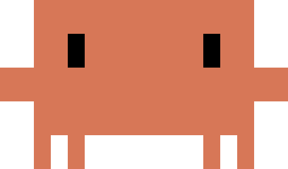

# Claude Jelly 🪼

[中文](README.md) | English

A floating desktop jellyfish that opens and hides the Windows Terminal window running [Claude Code](https://claude.com/claude-code) with a single click.



## Features

- **Click the jellyfish**: opens or focuses a Windows Terminal window running Claude Code.
- **Click again** (or press `Ctrl+Alt+J`, or minimize the terminal): the terminal hides, leaving only the floating jellyfish; the session keeps running.
- **Edge hiding**: drag the jellyfish near any screen edge and release; it tucks outside the edge with only its head visible. Hover to reveal it again; it retracts after the pointer leaves.
- **Status bubbles**: whenever Claude Code is running (terminal shown or hidden), the jellyfish blows bubbles upward and drifts toward the inner side of the screen (left when docked to the right), so they are not clipped at the edge. A small dot appears only while launching or after a failed launch.
- **Top-edge easter egg**: dock it to the top edge and it hangs down with gently swaying tentacles (only while Claude Code is running) and stops blowing bubbles.
- **Terminal adoption**: after you close the current terminal, the jellyfish adopts the most recent terminal it opened that is still alive, so the bubble state is not lost by closing the wrong window.
- **Custom sprite**: right-click → Sprite to use any PNG / JPG / GIF / BMP / WebP image (scaled proportionally; bubbles and edge hiding still work), and reset to the default jellyfish at any time.
- **Display language**: right-click → Language to switch between 中文 and English; the choice is saved.
- **Right-click menu**: size, opacity, float speed, sprite, display language, start with Windows, always on top, model provider.
- **Model providers**: choose Official Claude, DeepSeek, or a custom Anthropic-compatible endpoint from right-click → Settings.

## Requirements

- Windows 10 / 11
- [uv](https://docs.astral.sh/uv/)
- Windows Terminal (`wt.exe`)
- Claude Code CLI installed (`claude`)

## Install and run

```powershell
git clone <repository-url>
cd claude-jelly
uv sync
uv run claude-jelly
```

Without uv, you can also install directly:

```powershell
python -m pip install .
claude-jelly
```

## Usage

| Action | Effect |
| --- | --- |
| Left click | Open / hide the terminal window |
| Left drag | Move the jellyfish; release near a screen edge to hide it |
| Right click | Open the settings menu |
| Right click → Language | Switch between 中文 and English |
| Hover | Show the tooltip; reveal the jellyfish while hidden at an edge |
| `Ctrl+Alt+J` | Global hotkey, same as clicking the jellyfish |

### Model providers

Right-click → **Settings** → **Model provider**:

- **Official Claude**: injects no environment variables and uses Claude Code's own configuration.
- **DeepSeek**: default endpoint `https://api.deepseek.com/anthropic`, model `deepseek-flash`.
- **Custom…**: enter the base URL, model name, and API key of any Anthropic-compatible endpoint.

Selecting a provider generates a machine-local `provider-settings.json` and passes it to `claude --settings <file>` for that terminal session only; your global `~/.claude/settings.json` is not modified. The API key is stored only in the local config directory and is never uploaded.

### Config file locations

| Content | Path |
| --- | --- |
| Window settings | `%LOCALAPPDATA%\ClaudeJelly\config.json` |
| Session provider settings | `%LOCALAPPDATA%\ClaudeJelly\provider-settings.json` |
| Launch script | `%LOCALAPPDATA%\ClaudeJelly\launch.cmd` |
| Log | `%LOCALAPPDATA%\ClaudeJelly\jelly.log` |

The display language is stored in the `language` field of `config.json` (`zh` / `en`).

## Project structure

```
claude-jelly/
├── pyproject.toml              # uv / packaging config
└── src/claude_jelly/
    ├── __init__.py             # version
    ├── __main__.py             # python -m / claude-jelly entry point
    ├── app.py                  # app composition, message loop, interaction state
    ├── config.py               # constants, paths, config I/O, logging
    ├── i18n.py                 # Chinese/English strings and current language
    ├── controllers/            # UI-independent state machines
    │   ├── docking.py          # edge snapping / hiding position / easing
    │   └── terminal.py         # terminal launch, hide, adoption and state
    ├── services/               # local integrations
    │   ├── autostart.py        # startup shortcut
    │   └── providers.py        # Anthropic-compatible provider config
    ├── ui/
    │   ├── window.py           # layered transparent window and DIB composition
    │   ├── menu.py             # context menu (returns commands only)
    │   ├── provider_dialog.py  # provider config dialog
    │   └── render/             # pure drawing, no window dependency
    │       ├── constants.py    # size / bubble / sprite constants
    │       ├── sprite.py       # sprite loading and scale cache
    │       ├── geometry.py     # head / body rectangles
    │       ├── bubbles.py      # bubble particles
    │       ├── jelly.py        # procedural fallback jellyfish
    │       ├── frame.py        # frame composition
    │       ├── util.py         # fonts / gradients / premultiplied pixels
    │       └── preview.py      # preview image generation
    ├── winapi/                 # the only ctypes boundary
    │   ├── bindings.py         # DLLs, constants, structs, signatures
    │   ├── screen.py           # DPI / work area / focus
    │   ├── terminals.py        # terminal window detection and enumeration
    │   └── dialogs.py          # system file picker
    └── assets/
        └── claude_sprite.png
```

Layering rules:

- `winapi/` is the only place that calls Win32 / ctypes directly;
- `controllers/` only handles state and geometry, and never touches the window or drawing;
- `ui/render/` is pure functional drawing: state in, RGBA out;
- `app.py` only composes and dispatches interactions; it implements no capability itself.

## Development

```powershell
uv sync
uv run python -m claude_jelly            # start
uv run claude-jelly-preview              # write preview images to %LOCALAPPDATA%\ClaudeJelly\previews
uvx ruff check src/claude_jelly          # lint
```

## License

[MIT License](LICENSE)
