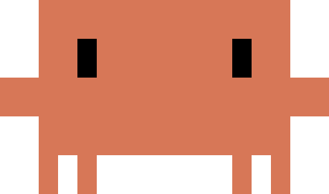

# Claude Jelly 🪼

桌面悬浮小水母，用来一键打开 / 收起运行 [Claude Code](https://claude.com/claude-code) 的 Windows Terminal 窗口。



## 功能

- **点一下水母**：打开或聚焦一个运行 Claude Code 的 Windows Terminal 窗口
- **再点一下**（或 `Ctrl+Alt+J`、最小化终端）：终端收起，只剩悬浮的小水母，会话不中断
- **边缘躲藏**：把水母拖到屏幕任意边缘附近松手，它会躲到边缘外只露出脑袋；鼠标移上去重新探出，离开后自动缩回
- **状态提示**：只要 Claude Code 在运行（终端窗口显示或已收起），水母就会向上吐泡泡，并朝屏幕内侧飘（贴右边就往左飘），贴边也不会被裁掉；仅启动中 / 启动失败时显示小圆点
- **顶边彩蛋**：把水母贴到屏幕上边缘，它会挂在边缘垂下触手轻轻晃（Claude Code 在运行时才晃），不再吐泡泡
- **终端接管**：关闭当前终端后，水母会自动接管最近由它打开、仍然存在的那个终端，泡泡状态不会因为关错窗口而丢失
- **自定义悬浮图片**：右键菜单 → 悬浮图片，可选 PNG / JPG / GIF / BMP / WebP 换成任意形象（自动等比缩放，泡泡和躲藏行为照常），随时一键恢复默认水母
- **右键菜单**：大小、透明度、浮动频率、悬浮图片、开机自启、置顶、大模型接口
- **大模型接口**：在右键菜单 → 设置里选择官方 Claude、DeepSeek 或自定义 Anthropic 兼容接口

## 环境要求

- Windows 10 / 11
- [uv](https://docs.astral.sh/uv/)
- Windows Terminal（`wt.exe`）
- 已安装 Claude Code CLI（`claude`）

## 安装与运行

```powershell
git clone <仓库地址>
cd claude-jelly
uv sync
uv run claude-jelly
```

不想走 uv 的话，也可以直接：

```powershell
python -m pip install .
claude-jelly
```

## 使用

| 操作 | 效果 |
| --- | --- |
| 左键单击 | 打开 / 收起终端窗口 |
| 左键拖动 | 移动水母；靠近屏幕边缘松手会自动躲藏 |
| 右键 | 打开设置菜单 |
| 鼠标悬停 | 显示提示、躲藏状态下探出身体 |
| `Ctrl+Alt+J` | 全局快捷键，等同单击水母 |

### 大模型接口

右键菜单 → **设置** → **大模型接口**：

- **官方 Claude**：不注入任何环境变量，使用 Claude Code 自身配置
- **DeepSeek**：默认接口 `https://api.deepseek.com/anthropic`，模型 `deepseek-flash`
- **自定义…**：填写任意 Anthropic 兼容接口的地址、模型名和 API Key

选择后会生成本机专用的 `provider-settings.json`，通过 `claude --settings <文件>` 只对本次终端会话生效，不会修改你的全局 `~/.claude/settings.json`。API Key 只保存在本机配置目录，不会上传。

### 配置文件位置

| 内容 | 路径 |
| --- | --- |
| 窗口配置 | `%LOCALAPPDATA%\ClaudeJelly\config.json` |
| 会话接口配置 | `%LOCALAPPDATA%\ClaudeJelly\provider-settings.json` |
| 启动脚本 | `%LOCALAPPDATA%\ClaudeJelly\launch.cmd` |
| 日志 | `%LOCALAPPDATA%\ClaudeJelly\jelly.log` |

## 项目结构

```
claude-jelly/
├── pyproject.toml              # uv / 打包配置
└── src/claude_jelly/
    ├── __init__.py             # 版本号
    ├── __main__.py             # python -m / claude-jelly 入口
    ├── app.py                  # 组装应用、消息循环、交互状态
    ├── config.py               # 常量、路径、配置读写、日志
    ├── controllers/            # 与界面无关的状态机
    │   ├── docking.py          # 边缘吸附 / 躲藏位置 / 缓动
    │   └── terminal.py         # 终端启动、收起、接管与状态
    ├── services/               # 本机集成
    │   ├── autostart.py        # 开机自启快捷方式
    │   └── providers.py        # Anthropic 兼容接口配置
    ├── ui/
    │   ├── window.py           # 分层透明窗口与 DIB 合成
    │   ├── menu.py             # 右键菜单（只返回命令）
    │   ├── provider_dialog.py  # 接口配置对话框
    │   └── render/             # 纯绘制，无窗口依赖
    │       ├── constants.py    # 尺寸 / 泡泡 / 精灵图常量
    │       ├── sprite.py       # 形象加载与缩放缓存
    │       ├── geometry.py     # 脑袋 / 身体矩形
    │       ├── bubbles.py      # 泡泡粒子
    │       ├── jelly.py        # 程序化兜底水母
    │       ├── frame.py        # 帧合成
    │       ├── util.py         # 字体 / 渐变 / 预乘像素
    │       └── preview.py      # 预览图生成
    ├── winapi/                 # 唯一的 ctypes 边界
    │   ├── bindings.py         # DLL、常量、结构体、函数签名
    │   ├── screen.py           # DPI / 工作区 / 焦点
    │   ├── terminals.py        # 终端窗口识别与枚举
    │   └── dialogs.py          # 系统文件选择框
    └── assets/
        └── claude_sprite.png
```

分层约定：

- `winapi/` 是唯一直接调用 Win32 / ctypes 的地方；
- `controllers/` 只做状态与几何计算，不碰窗口和绘制；
- `ui/render/` 是纯函数式绘制，输入状态输出 RGBA；
- `app.py` 只负责组装与交互调度，不实现具体能力。

## 开发

```powershell
uv sync
uv run python -m claude_jelly            # 启动
uv run claude-jelly-preview              # 输出渲染预览图到 %LOCALAPPDATA%\ClaudeJelly\previews
uvx ruff check src/claude_jelly          # 代码检查
```

## 许可

[MIT License](LICENSE)
